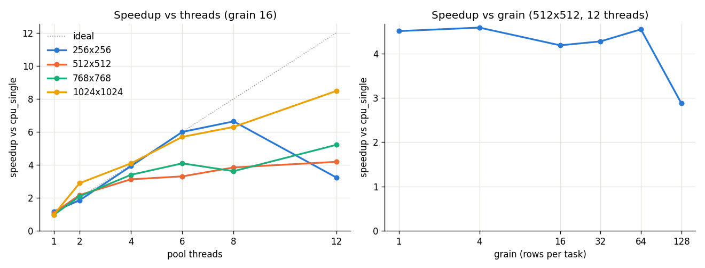

# ParaForge

Matrix-multiplication runtime (CPU threads, then CUDA), built in phases. Implemented so far:

- `paraforge::Matrix`: dense row-major `float` matrix.
- `paraforge::matmul_reference`: single-threaded reference multiply (correctness baseline).
- `paraforge::ThreadPool`: fixed worker count, shared FIFO task queue, `submit`, `wait_all`, draining shutdown.
- `paraforge::matmul_parallel(a, b, pool, grain)`: splits output rows into blocks of `grain` rows,
  one pool task per block. Every element uses the same arithmetic and order as the reference,
  so results are bitwise identical. The call waits on `pool.wait_all()`, so do not share the pool
  with other work while it runs.
- `paraforge_bench`: timing of single-threaded vs parallel multiply, CSV output.
- `bench/plot.py`: speedup chart from the benchmark CSV.
- `paraforge::matmul_cuda_naive(a, b, timings)` (optional, needs `nvcc`): naive CUDA kernel, one
  thread per output element, any `m x k` by `k x n` shape. See [CUDA](#cuda).
- `paraforge::matmul_cuda_tiled(a, b, timings)` (optional, needs `nvcc`): same API, kernel stages
  16x16 tiles of A and B in shared memory. Same host code (allocation, copies, timing) as the naive one.

A device memory pool is not implemented (it was optional in the plan).

## Result

On an Intel i5-12450H (8 cores / 12 threads, GCC 15.2 Release), 1024x1024 with 12 threads and
grain 16 ran in 520 / 592 ms vs 4913 / 4448 ms single-threaded in the same runs (medians of 5
repeats, 2 passes): speedup 9.5x and 7.5x, median **8.5x**. Smaller sizes peak at 4.2-6.6x. That
1024 baseline is unusually slow (likely cache conflicts in the naive kernel), which inflates its
speedup; see [docs/results.md](docs/results.md) for the
full table, method and caveats.



GPU, kernel time only (RTX 3050 Laptop, kernels JIT-compiled with NVRTC, no copies): the tiled
kernel is **1.27-1.37x** faster than the naive one on the same inputs (1024^3: 4.40 vs 5.82 ms,
~488 vs ~369 GFLOPS). No end-to-end GPU numbers yet; see [docs/results.md](docs/results.md#gpu).

## Build and test

Requires CMake >= 3.16 and a C++17 compiler (GCC, Clang or MSVC).
GoogleTest is used from the system if CMake can find it, otherwise downloaded at configure time.

```sh
cmake -S . -B build -DCMAKE_BUILD_TYPE=Release
cmake --build build --config Release
ctest --test-dir build -C Release --output-on-failure
```

Pass `-DPARAFORGE_BUILD_TESTS=OFF` to skip tests (and the GoogleTest download).

## Benchmark

```sh
build/paraforge_bench [size] [threads] [grain] [repeats]
```

All arguments are optional positive integers, positional, in that order. Bad arguments, or a
`size` too large to allocate, exit with code 2.
Defaults: `size=512`, `threads=` hardware concurrency, `grain=16` rows per task, `repeats=5`.
With a multi-config generator (Visual Studio) the binary is in `build/Release/`.

The benchmark multiplies two random `size x size` matrices (fixed seed). It first runs both
kernels once, untimed, and exits with code 1 if the results differ. It then times `repeats` runs
of each kernel, checks the last timed results match too (exit 1 if not), and prints the median
wall time in milliseconds. Pool thread startup is not timed.

```text
impl,size,threads,grain,repeats,time_ms
cpu_single,<size>,1,<size>,<repeats>,<median ms>
cpu_parallel,<size>,<threads>,<grain>,<repeats>,<median ms>
```

`cpu_single` reports `grain=size` because it computes all rows as one block.
To sweep a parameter, loop in the shell and drop repeated headers, e.g.:

```sh
for t in 1 2 4 8; do build/paraforge_bench 512 $t 16 5 | tail -n +2; done
```

Numbers depend on the machine, compiler and load; the build defaults to `Release` for that reason.

## Plot

Needs Python 3 with matplotlib. Rows must stay in the order the benchmark prints them
(each `cpu_parallel` row right after its `cpu_single` row).

```sh
python bench/plot.py [csv] [png]   # defaults: docs/cpu_bench.csv docs/cpu_speedup.png
```

## CUDA

Optional; off by default so the CPU build needs no CUDA toolkit. Needs the CUDA toolkit
(`nvcc`), CMake >= 3.24 and, on Windows, MSVC (`nvcc` uses it as host compiler).

```sh
cmake -S . -B build -DCMAKE_BUILD_TYPE=Release -DPARAFORGE_ENABLE_CUDA=ON
cmake --build build --config Release
ctest --test-dir build -C Release --output-on-failure   # adds paraforge_cuda_tests
build/paraforge_cuda_bench [m] [k] [n] [repeats]         # defaults: 1024 1024 1024 5
```

Code is compiled for the GPU in the build machine (`CMAKE_CUDA_ARCHITECTURES=native`); pass e.g.
`-DCMAKE_CUDA_ARCHITECTURES=75` to target another GPU. `paraforge_cuda_tests` skip their GPU cases
when no CUDA device is present.

`paraforge_cuda_bench` multiplies random `m x k` and `k x n` matrices in `[-1, 1]` (fixed seed),
runs the naive and then the tiled kernel on those same inputs, checks every call against the CPU
reference (exit 1 if `max |gpu - cpu| > 1e-5 * k`; exit 3 on a CUDA error, e.g. no device) and
prints one CSV row per kernel (`cuda_naive`, `cuda_tiled`); every `*_ms` column is the median of
`repeats` calls, after one untimed warm-up call per kernel:

```text
impl,m,k,n,repeats,h2d_ms,kernel_ms,d2h_ms,end_to_end_ms,kernel_gflops,end_to_end_gflops,max_abs_err
```

- `kernel_ms`: kernel only (CUDA events). `kernel_gflops = 2*m*n*k / kernel time`.
- `h2d_ms` / `d2h_ms`: copying A, B to the GPU / C back (CUDA events, pageable host memory).
- `end_to_end_ms`: host wall time of the whole `matmul_cuda_naive` / `matmul_cuda_tiled` call,
  including device allocation and free. `end_to_end_gflops` uses it.

No CUDA toolkit locally? Two options:

- **Google Colab**: open [notebooks/colab_cuda.ipynb](notebooks/colab_cuda.ipynb) in Colab with a
  GPU runtime; it builds with CMake, runs the tests and the benchmark.
- **Kernel-only check with just an NVIDIA driver**: `bench/nvrtc_kernel_check.py` JIT-compiles
  `src/matmul_naive_kernel.cuh` and `src/matmul_tiled_kernel.cuh` with NVRTC (pip wheel), runs
  both through the driver API on the same inputs, checks them against NumPy (including NaN guard
  zones past A, B and C that catch out-of-bounds reads and writes) and times each kernel.
  `--csv FILE` appends timestamped rows (only if every check passed). It does not build or test
  the C++ host code.

  ```sh
  python -m venv .venv
  .venv/Scripts/pip install numpy "nvidia-cuda-nvrtc-cu12==12.2.*"   # match your driver's CUDA version (nvidia-smi)
  .venv/Scripts/python bench/nvrtc_kernel_check.py [m k n repeats] [--csv docs/gpu_kernel_bench.csv]
  ```

## Limitations

- No memory pool: both CUDA functions allocate and free device memory on every call.
- The tiled kernel is the textbook 16x16 shared-memory version (no register blocking, vectorized
  loads or double buffering); it is ~1.3x the naive kernel, far from cuBLAS.
- The CMake CUDA build (`src/matmul_cuda.cu`, `paraforge_cuda_tests`, `paraforge_cuda_bench`) has
  not been compiled on the author's machine (no `nvcc`/MSVC there); only the two kernel sources
  have run locally, via `bench/nvrtc_kernel_check.py`. See [docs/results.md](docs/results.md#gpu).
- Naive `i, j, k` kernel (no tiling or SIMD): good for checking the thread split, slow as a GEMM.
- `matmul_parallel` assumes it has the pool to itself while it runs.
- Published numbers come from one laptop, 2 passes each, no CPU pinning; run-to-run spread is large
  (see [docs/results.md](docs/results.md#caveats)).

Design notes: [docs/design.md](docs/design.md).
