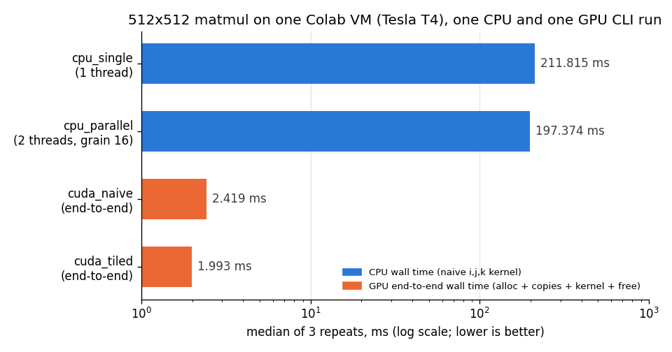

# Results

Data: [`cpu_bench.csv`](cpu_bench.csv). Chart: `python bench/plot.py` (matplotlib).

## Method

- Machine: Intel Core i5-12450H (4 P-cores with HT + 4 E-cores = 8 cores, 12 logical CPUs),
  Windows 11 laptop, no CPU isolation.
- Build: GCC 15.2.0 (MSYS2 UCRT64), Ninja, `CMAKE_BUILD_TYPE=Release`.
- Each `paraforge_bench size threads grain 5` call prints the median of 5 timed repeats for
  `cpu_single` and for `cpu_parallel` (see [design.md](design.md#measurement)).
- 29 configs, swept twice in full (2 passes, 58 CLI runs). Each CSV row pair is one run.
  A partial third pass was stopped early and dropped; it is not in the CSV.
- Speedup per run = `cpu_single` median / `cpu_parallel` median from that same run. The table
  shows the median over the 2 passes, which with 2 values is their mean. The range is the two
  per-pass speedups.

## Thread sweep (grain 16)

Speedup, median of 2 passes (min-max):

| size | 1 | 2 | 4 | 6 | 8 | 12 |
|-----:|--:|--:|--:|--:|--:|---:|
| 256  | 1.17 (1.08-1.27) | 1.85 (1.49-2.22) | 3.92 (3.88-3.97) | 6.00 (4.15-7.84) | 6.64 (5.68-7.59) | 3.23 (1.68-4.78) |
| 512  | 1.08 (0.87-1.29) | 2.17 (2.00-2.34) | 3.12 (2.72-3.53) | 3.30 (3.11-3.49) | 3.84 (3.56-4.13) | 4.18 (3.34-5.03) |
| 768  | 0.97 (0.96-0.98) | 2.09 (2.01-2.18) | 3.39 (3.23-3.56) | 4.09 (3.70-4.49) | 3.62 (3.48-3.75) | 5.21 (4.34-6.09) |
| 1024 | 0.98 (0.96-1.00) | 2.89 (2.71-3.07) | 4.09 (3.93-4.25) | 5.70 (4.73-6.67) | 6.30 (5.09-7.51) | 8.48 (7.51-9.45) |

Absolute medians, ms (pass 1 / pass 2):

| size | cpu_single (all runs, min-max) | cpu_parallel, 12 threads |
|-----:|-------------------------------:|-------------------------:|
| 256  | 15.1-24.4    | 8.99 / 3.53 |
| 512  | 100-227      | 32.9 / 30.0 |
| 768  | 454-664      | 109.1 / 109.5 |
| 1024 | 3590-5138    | 520 / 592 |

## Grain sweep (512x512, 12 threads)

| grain | 1 | 4 | 16 | 32 | 64 | 128 |
|------:|--:|--:|---:|---:|---:|----:|
| speedup | 4.50 | 4.58 | 4.18 | 4.27 | 4.54 | 2.88 |
| min-max | 4.32-4.69 | 4.52-4.65 | 3.34-5.03 | 4.08-4.46 | 4.12-4.97 | 2.02-3.74 |

Grain 1-64 are within noise of each other. Grain 128 gives only `512 / 128 = 4` tasks, so at
most 4 of 12 threads work, which matches the drop.

## Reading the numbers

- 1 thread through the pool is about the same speed as `cpu_single` (medians 0.97-1.17): pool overhead is
  small at these sizes.
- Scaling is well below linear past 4 threads. The CPU has only 4 fast cores; 6-12 threads land
  on E-cores and hyper-threads.
- 256x256 at 12 threads (3.23) is lower than at 8 threads (6.64): one 256 run is only ~3-9 ms, so
  thread wake-up and OS scheduling noise dominate; the two passes disagree by almost 3x.
- 1024x1024 scales best (8.48 at 12 threads), but its single-thread baseline is unusually slow:
  median 4363 ms vs 529 ms at 768, i.e. ~8.2x the time for ~2.4x the work. The naive `i, j, k` loop reads
  `b` down a column with a 4 KiB stride at 1024, which likely causes cache-set conflicts (not profiled). Part of
  the 1024 "speedup" is splitting that bad access pattern across more cores and caches, not pool
  efficiency.

## Caveats

- Only 2 passes per config; per-pass speedups differ by up to ~3x (256, 12 threads). Treat
  differences smaller than the min-max ranges above as noise.
- `cpu_single` varies by up to ~2.3x between runs of the same size (e.g. 512: 100-227 ms)
  likely from background load, turbo and P/E-core placement. No CPU pinning or power settings were
  fixed.
- One machine, one compiler. Results do not transfer to other CPUs.
- The kernel is naive (no tiling, transposition or SIMD). Absolute times are far from a tuned
  GEMM; these numbers measure the thread pool split, not a fast kernel.
- The tables above are local CPU numbers only; GPU results (and the Colab CPU run) are below.

## GPU

Two separate GPU data sets, from different machines; do not mix them:

- [Colab Tesla T4, CMake build](#colab-tesla-t4-cmake-build): full host code, tests, end-to-end times.
- [Local RTX 3050, NVRTC kernel check](#local-rtx-3050-nvrtc-kernel-check): kernels only, no host code.

The local Windows CPU tables above are **not** comparable with Colab GPU times (different CPU,
OS, compiler and load).

### Colab Tesla T4, CMake build

- Machine: Google Colab VM, NVIDIA Tesla T4 (compute capability 7.5), driver 580.82.07,
  `nvcc` CUDA 13.0 V13.0.88, GNU C++ 13.3.0, CMake 3.31.10, `CMAKE_BUILD_TYPE=Release`,
  `-DPARAFORGE_ENABLE_CUDA=ON`.
- Build: configure and build succeeded; `ctest`: **51/51 tests passed** (6.98 s), including
  `paraforge_cuda_tests` on the T4.
- Each data set below is **one CLI invocation**; every time is the median of the repeats inside
  that run (5 for 1024, 3 for 512). No second pass, so no run-to-run spread is known.
- Raw rows: [`colab_t4_cuda_bench.csv`](colab_t4_cuda_bench.csv) (`paraforge_cuda_bench 1024 1024 1024 5`
  and `paraforge_cuda_bench 512 512 512 3`), [`colab_t4_cpu_bench.csv`](colab_t4_cpu_bench.csv)
  (`paraforge_bench` 512, 2 threads, grain 16, 3 repeats). All on the same VM session.

GPU, `paraforge_cuda_bench` (columns as in the [README](../README.md#cuda)):

| m = k = n | kernel | repeats | h2d ms | kernel ms | d2h ms | end-to-end ms | kernel GFLOPS | end-to-end GFLOPS | max abs err |
|----:|-------|--:|------:|------:|------:|-------:|------:|------:|---------:|
| 1024 | naive | 5 | 1.900 | 6.341 | 0.737 | 10.004 | 338.6 | 214.7 | 7.63e-05 |
| 1024 | tiled | 5 | 1.798 | 4.062 | 0.734 | 7.657  | 528.6 | 280.5 | 7.63e-05 |
| 512  | naive | 3 | 0.637 | 1.131 | 0.252 | 2.419  | 237.3 | 111.0 | 3.81e-05 |
| 512  | tiled | 3 | 0.592 | 0.750 | 0.247 | 1.993  | 358.1 | 134.7 | 3.81e-05 |

Tiled vs naive (ratio of medians, same run, same inputs):

| size | kernel-only | end-to-end |
|-----:|------------:|-----------:|
| 1024 | 6.341 / 4.062 = **1.56x** | 10.004 / 7.657 = **1.31x** |
| 512  | 1.131 / 0.750 = **1.51x** | 2.419 / 1.993 = **1.21x** |

End-to-end gains are smaller because copies and allocation cost about the same for both kernels
(end-to-end minus kernel: about 3.6 ms at 1024, 1.2-1.3 ms at 512).

512x512, all four methods on the same Colab VM (chart: `python bench/plot_colab.py`). CPU is
`paraforge_bench` wall time; GPU is `end_to_end_ms` (allocation + H2D + kernel + D2H + free),
not kernel-only:

| method | median ms | vs cpu_single | vs cpu_parallel |
|--------|----------:|--------------:|----------------:|
| cpu_single (1 thread) | 211.815 | 1.00x | - |
| cpu_parallel (2 threads, grain 16) | 197.374 | 1.07x | 1.00x |
| cuda_naive, end-to-end | 2.419 | 87.6x | 81.6x |
| cuda_tiled, end-to-end | 1.993 | 106.3x | **99.0x** |

Limits of this comparison:

- The CPU kernel is the deliberately naive `i, j, k` loop (no tiling, SIMD or transposition),
  and this VM ran it with only 2 pool threads; 2 threads gave just 1.07x over 1 thread here. A
  tuned CPU GEMM or a bigger CPU would shrink the ~99x a lot. The ratio describes this VM and
  this workload only, not CPU vs GPU in general.
- One CLI run per device, 3 repeats each; Colab VMs are shared, so noise is unknown.
- GPU end-to-end excludes CUDA context creation (untimed warm-up) and host input generation;
  CPU time excludes input generation and pool start-up.

### Local RTX 3050, NVRTC kernel check

The CMake CUDA build has not been compiled on the author's Windows machine (NVIDIA driver, but
no `nvcc` or MSVC). Only the two kernel sources ran there, through `bench/nvrtc_kernel_check.py`
(NVRTC 12.2 from pip, driver API, CUDA-event timing of the kernel alone, `sm_86` cubin, 16 x 16 blocks):

- GPU: NVIDIA GeForce RTX 3050 Laptop GPU (4 GiB, 60 W cap), driver 537.70 (CUDA 12.2), Windows 11.
- Correctness, both kernels: 15 fixed shapes from `1x1x1` to `1000x700x300` (tiny, odd, 15/16/17,
  partial tiles in `m`, `k` and `n`, `1 x k`, `k x 1`, `k = 1`) plus every timed run below, all
  within `1e-5 * k` of a float64 NumPy reference, no writes past C, no use of the NaN guard
  zones past A and B. Both kernels gave the same max error on every shape.
- Timing: for each shape both kernels run on the **same inputs**, alternating, 10 timed rounds after
  1 warm-up round; median kernel time. Two separate runs of the script (passes), 2026-10-23.
  Raw rows with UTC timestamps: [`gpu_kernel_bench.csv`](gpu_kernel_bench.csv).

| m x k x n | naive ms (pass 1 / 2) | tiled ms (pass 1 / 2) | naive GFLOPS | tiled GFLOPS | tiled speedup (pass 1 / 2) |
|----------:|----------------------:|----------------------:|-------------:|-------------:|---------------------------:|
| 512 x 512 x 512       | 0.756 / 0.795   | 0.585 / 0.581   | 338-355 | 459-462 | 1.29 / 1.37 |
| 1000 x 700 x 300      | 1.249 / 1.235   | 0.983 / 0.974   | 336-340 | 427-431 | 1.27 / 1.27 |
| 1024 x 1024 x 1024    | 5.860 / 5.785   | 4.402 / 4.390   | 366-371 | 488-489 | 1.33 / 1.32 |
| 2048 x 512 x 1024     | 5.766 / 5.766   | 4.395 / 4.402   | 372-373 | 488-489 | 1.31 / 1.31 |
| 2048 x 2048 x 2048    | 45.426 / 45.416 | 34.863 / 34.840 | 378 | 493 | 1.30 / 1.30 |

Reading it:

- Tiled is 1.27-1.37x faster than naive at every shape, including `1000 x 700 x 300` where no
  dimension is a multiple of 16. The two passes agree within ~6%.
- The gain is modest. Likely reason (not profiled): the naive kernel already gets much of its
  reuse from the L1/L2 caches, and the 16x16 tiled kernel is limited by two shared-memory reads per
  multiply-add. See [design.md](design.md#cuda-kernel-tiled).
- The naive 1024^3 median (5.78-5.86 ms) matches the earlier naive-only run (5.752 ms).
- A few single rounds were far off the median (e.g. a 114 ms and a 122 ms naive round at 2048^3,
  a 27.3 ms tiled round), probably clock/power changes on the laptop; medians are stable.
- All numbers exclude copies and allocation. They say nothing about end-to-end speed against the
  CPU. One laptop, clocks vary with power and temperature.
- The T4 kernel-only gain (1.51-1.56x) is higher than here (1.27-1.37x); different GPU, compiler
  (`nvcc` 13.0 vs NVRTC 12.2) and build path, so the two are not directly comparable.
